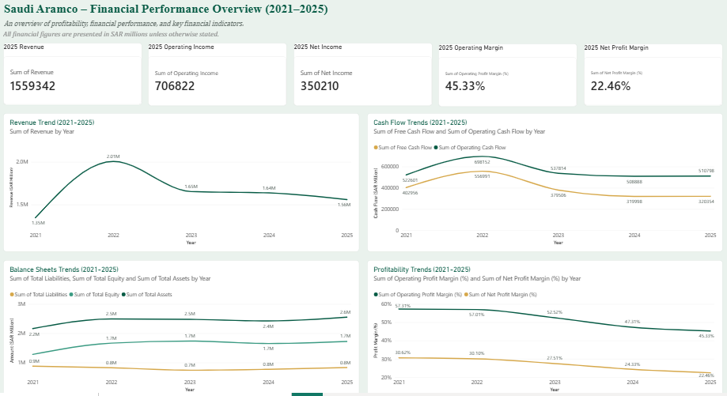
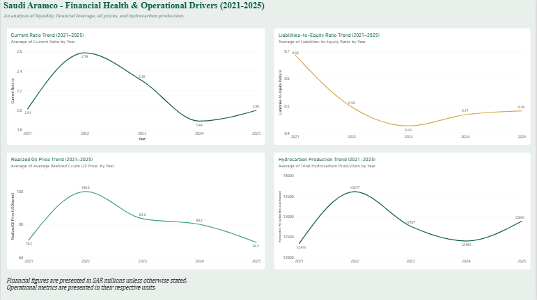
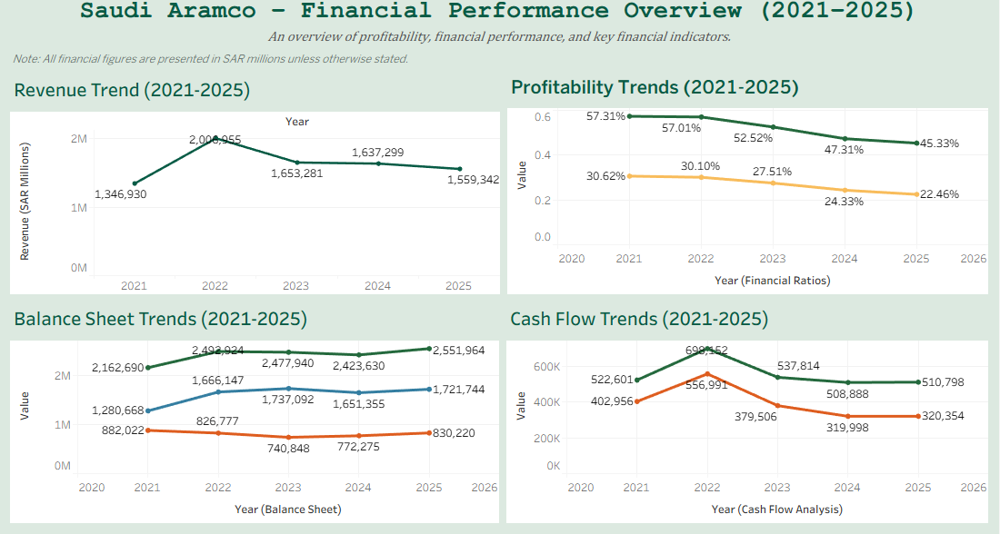
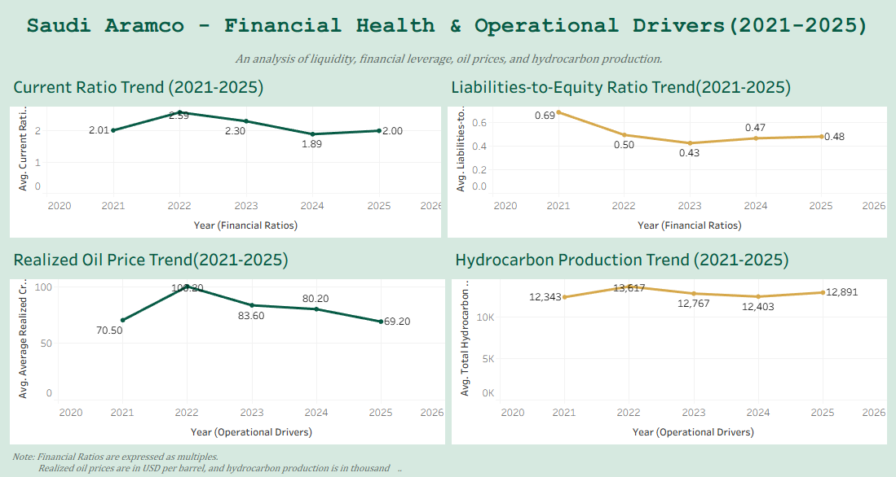

Saudi Aramco – Financial Analysis (2021–2025)

Project Overview

A comprehensive financial and operational analysis of Saudi Aramco covering the five-year period from 2021 to 2025.

This project examines the company's financial performance, profitability, cost structure, liquidity, cash flow, and operational drivers using multiple data analytics tools.

Objectives

- Analyze revenue, operating income, and net income trends.
- Evaluate profitability through financial ratios.
- Examine the company's cost structure.
- Assess liquidity and financial stability.
- Analyze operating cash flow, free cash flow, and dividend coverage.
- Explore the relationship between oil prices, hydrocarbon production, and revenue.
- Present findings through interactive dashboards and a final report.

Key Findings
| Metric | 2022 | 2025 | Change |
|---|---:|---:|---:|
| Revenue (SAR million) | 2,006,955 | 1,559,342 | -22.30% |
| Operating Income (SAR million) | 1,144,077 | 706,822 | -38.22% |
| Net Income (SAR million) | 604,005 | 350,210 | -42.02% |
| Operating Profit Margin | 57.01% | 45.33% | -11.68 pp |
| Net Profit Margin | 30.10% | 22.46% | -7.64 pp |
| Current Ratio | 2.59 | 2.00 | -0.59 |
| Free Cash Flow (SAR million) | 556,991 | 320,354 | -42.49% |
| Dividend Coverage | 1.98 | 1.00 | -0.98 |

Project Deliverables

| Folder | Deliverable | Format |
|---|---|---|
| 01_Excel | Financial Analysis Workbook | `.xlsx` |
| 02_SQL | SQL Analysis Script | `.sql` |
| 03_Python | Python Analysis | `.ipynb`, `.xlsx` |
| 04_Power_BI | Interactive Dashboard | `.pbix`, `.pdf` |
| 05_Tableau | Tableau Dashboard | `.twbx` |
| 06_Final_Report | Final Financial Analysis Report | `.docx`, `.pdf` |

## Dashboard Previews

### Power BI

### Tableau

Data Source
Financial and operational information was collected from Saudi Aramco's official annual reports for 2021–2025.

[Saudi Aramco – Annual Reports](https://www.aramco.com/en/investors/annual-report/downloads)

Conclusion
Saudi Aramco maintained a reasonable financial position during 2021–2025, but declining profitability and pressure on free cash flow highlighted areas requiring attention. This project demonstrates the use of Excel, SQL, Python, Power BI, and Tableau to turn real-world financial data into meaningful insights.

Project Type: Financial Data Analysis  
Analysis Period: 2021–2025
